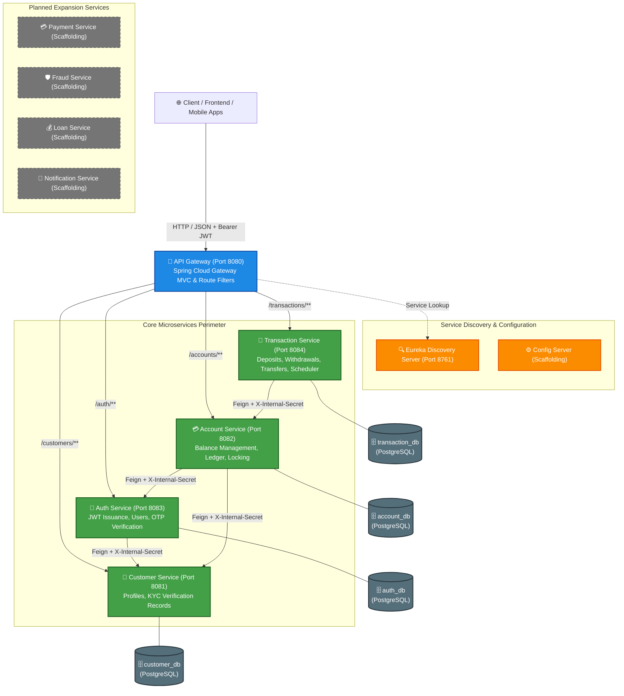
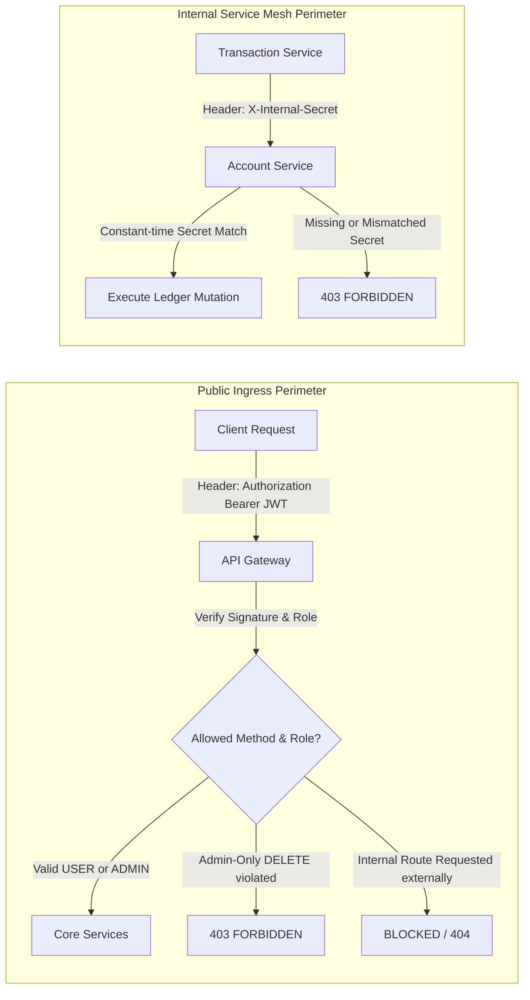
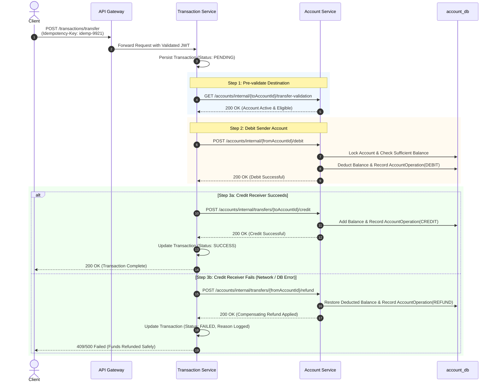
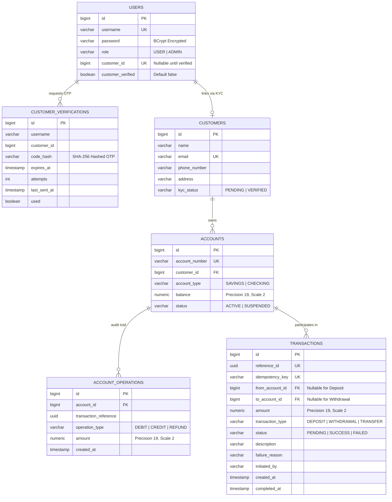
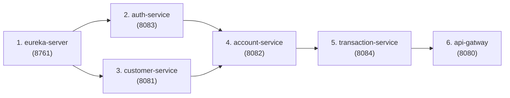

# 🏦 FINCORE — Distributed Core Banking & Financial Platform

[](https://openjdk.org/projects/jdk/21/)
[](https://spring.io/projects/spring-boot)
[](https://spring.io/projects/spring-cloud)
[](https://www.postgresql.org/)
[-green.svg?style=for-the-badge&logo=springsecurity)](https://spring.io/projects/spring-security)
[](#-system-architecture)
[](#-service-catalog--matrix)

> **Fincore** is an enterprise-grade, distributed core banking engine engineered for high-throughput, mission-critical financial operations. Built upon **Java 21**, **Spring Boot**, and **Spring Cloud**, Fincore delivers strict ACID guarantees, idempotent transaction lifecycles, distributed saga-based compensation, automated reconciliation, and a dual-perimeter zero-trust security architecture.

---

## 📑 Table of Contents

- [🌟 System Highlights & Core Capabilities](#-system-highlights--core-capabilities)
- [🏛️ System Architecture](#-system-architecture)
- [📦 Service Catalog & Matrix](#-service-catalog--matrix)
- [🛡️ Security Architecture & Zero-Trust Model](#-security-architecture--zero-trust-model)
- [🔄 Resiliency & Financial Consistency Mechanics](#-resiliency--financial-consistency-mechanics)
  - [1. Idempotency & Concurrency Control](#1-idempotency--concurrency-control)
  - [2. Distributed Transfer Saga & Compensating Refunds](#2-distributed-transfer-saga--compensating-refunds)
  - [3. Autonomous Self-Healing Reconciliation Scheduler](#3-autonomous-self-healing-reconciliation-scheduler)
- [📊 Data Models & Entity Relationship](#-data-models--entity-relationship)
- [🚀 Quickstart & Local Setup](#-quickstart--local-setup)
  - [Prerequisites](#prerequisites)
  - [Database Provisioning](#database-provisioning)
  - [Environment Configuration](#environment-configuration)
  - [Service Startup Sequence](#service-startup-sequence)
- [🎮 Interactive API Testing Cheatsheet](#-interactive-api-testing-cheatsheet)
  - [Complete User Journey Walkthrough](#complete-user-journey-walkthrough)
  - [Authentication & Customer Verification API](#authentication--customer-verification-api)
  - [Customer Management API](#customer-management-api)
  - [Account Operations API](#account-operations-api)
  - [Transaction Processing API](#transaction-processing-api)
- [🗺️ Future Service Roadmap](#-future-service-roadmap)
- [❓ Troubleshooting & Error Matrix](#-troubleshooting--error-matrix)

---

## 🌟 System Highlights & Core Capabilities

- **Zero-Trust Dual-Perimeter Security**: Public traffic is governed by Spring Cloud Gateway MVC using stateless **HMAC-SHA384 JWT** tokens and Role-Based Access Control (`USER` / `ADMIN`). Internal east-west traffic between microservices is isolated and cryptographically secured with constant-time `X-Internal-Secret` validation.
- **Strict Database-Per-Service Pattern**: Total domain isolation across dedicated PostgreSQL databases (`auth_db`, `customer_db`, `account_db`, `transaction_db`) eliminating distributed data coupling.
- **Double-Spend Prevention via Pessimistic Locking**: Account balance mutations employ database-level `PESSIMISTIC_WRITE` locks (`SELECT ... FOR UPDATE`), preventing race conditions during concurrent transactions.
- **End-to-End Financial Idempotency**: Strict HTTP `Idempotency-Key` validation combined with internal UUID transaction ledgers ensures safe retries across flaky networks.
- **Resilient Distributed Fund Transfers**: Implements a two-phase saga orchestration: validates destination account, debits sender, credits receiver, and automatically triggers compensating refunds if credit operations fail.
- **Autonomous Self-Healing Engine**: A background scheduled reconciliation process continuously monitors pending transfers, auto-resolving network split-brain states or executing refunds when appropriate.
- **Automated Customer KYC & Onboarding**: Two-stage onboarding workflow requiring email OTP verification before accounts can be linked or funds transacted.

---

## 🏛️ System Architecture



---

## 📦 Service Catalog & Matrix

| Service | Port | Database | Primary Responsibility | Authentication & Security | Status |
| :--- | :---: | :---: | :--- | :--- | :---: |
| **`eureka-server`** | `8761` | *None* | Centralized registry for dynamic discovery & load balancing | Network perimeter | 🟢 **Active** |
| **`api-gatway`** | `8080` | *None* | Unified entry point, route dispatching, client JWT validation, RBAC | JWT (HMAC-SHA384) | 🟢 **Active** |
| **`auth-service`** | `8083` | `auth_db` | User registration, authentication, JWT issuing, KYC OTP email dispatch & verification | BCrypt, JWT, Mail OTP, Internal Secret | 🟢 **Active** |
| **`customer-service`** | `8081` | `customer_db` | Customer KYC master data, profiles, and internal customer lookup | JWT + RBAC, Internal Secret | 🟢 **Active** |
| **`account-service`** | `8082` | `account_db` | Bank accounts (SAVINGS/CHECKING), balance locking, debit/credit ledger, internal operations | JWT + RBAC, Internal Secret, Pessimistic Locking | 🟢 **Active** |
| **`transaction-service`**| `8084` | `transaction_db` | Financial deposits, withdrawals, transfers, idempotency deduplication, auto-reconciliation scheduler | JWT + RBAC, Idempotency-Key, Internal Secret | 🟢 **Active** |
| **`config-server`** | Scaffolding | *None* | Distributed externalized application configuration server | Planned | 🟡 **Roadmap** |
| **`fraud-service`** | Scaffolding | *TBD* | Real-time fraud detection & risk evaluation engine | Planned | 🟡 **Roadmap** |
| **`loan-service`** | Scaffolding | *TBD* | Loan origination, underwriting, and installment schedules | Planned | 🟡 **Roadmap** |
| **`notification-service`** | Scaffolding | *TBD* | Multi-channel user notifications (SMS, Email, WebPush) | Planned | 🟡 **Roadmap** |
| **`payment-service`** | Scaffolding | *TBD* | External payment gateway integrations & settlements | Planned | 🟡 **Roadmap** |

---

## 🛡️ Security Architecture & Zero-Trust Model

Fincore adopts a **dual-perimeter security strategy** that eliminates single-point-of-failure vulnerabilities:



### 1. Public Perimeter: JWT + Role-Based Access Control (RBAC)
- All client tokens are signed with **HMAC-SHA384** (minimum 48-byte key requirement).
- Gateway inspects tokens, verifies `username` and `role` claims:
  - `USER`: May perform read and transactional operations on their own verified accounts.
  - `ADMIN`: Global query access and exclusive authorization for sensitive `DELETE` operations.
- The Gateway automatically blocks external requests attempting to hit `/customers/internal/**` or `/accounts/internal/**`.

### 2. Internal Perimeter: Zero-Trust Inter-Service Authentication
- Services calling each other directly via OpenFeign or RestClient (e.g., `transaction-service` ➔ `account-service`, or `account-service` ➔ `auth-service`) must supply the `X-Internal-Secret` header.
- Validated via `MessageDigest.isEqual(...)` to guard against timing side-channel attacks.

### 3. Customer Identity Verification & KYC Binding
- A user account in `auth-service` cannot transact until bound to a verified `Customer` profile.
- Verification flow generates a secure 6-digit OTP, stores a cryptographically salted SHA-256 hash in `customer_verifications`, and delivers it via SMTP mail.
- Once verified, `User.isCustomerVerified` is set to `true`, unlocking account creation and transfers.

---

## 🔄 Resiliency & Financial Consistency Mechanics

### 1. Idempotency & Concurrency Control
Every financial mutation endpoint in `transaction-service` requires a client-generated `Idempotency-Key` header (1 to 100 characters).

- **Double-Submit Protection**: If an in-flight request arrives with the same idempotency key, it is synchronized and handled safely.
- **Replay Resilience**: Subsequent requests with the same key immediately return the already recorded `TransactionResponse` without re-executing balance mutations.
- **Race Condition Prevention**: `account-service` executes balance updates inside a `@Transactional` boundary wrapped with `findByIdForUpdate(accountId)`, generating SQL `SELECT ... FOR UPDATE` row-level locks in PostgreSQL.

---

### 2. Distributed Transfer Saga & Compensating Refunds

When executing inter-account transfers, Fincore guarantees atomicity through a resilient orchestration saga:



---

### 3. Autonomous Self-Healing Reconciliation Scheduler

What if the server crashes or suffers a network partition **after** the debit succeeds but **before** the credit or refund completes?

Fincore features an automated background worker running in `transaction-service`:
- **Trigger**: Runs every 30 seconds (`fincore.reconciliation.fixed-delay: 30000`).
- **Scans**: Queries all records in `transaction_db` marked with `status = PENDING`.
- **Inquiry**: Calls `account-service` to determine the precise status of associated operation ledgers (`getOperationStatus`).
- **Resolution**:
  - If debit succeeded but credit was never applied, it attempts to complete the credit or initiates an automated refund to the sender.
  - Transactions stuck in transient states are moved to terminal `SUCCESS` or `FAILED` states.

---

## 📊 Data Models & Entity Relationship



---

## 🚀 Quickstart & Local Setup

### Prerequisites
- **JDK 21** or later (`java -version`)
- **Apache Maven 3.9+** (`mvn -v`)
- **PostgreSQL 15+** running on `localhost:5432`
- **SMTP Account** (e.g. Gmail App Password) for sending OTP emails

---

### Database Provisioning

Create the four isolated databases in PostgreSQL:

```sql
CREATE DATABASE auth_db;
CREATE DATABASE customer_db;
CREATE DATABASE account_db;
CREATE DATABASE transaction_db;
```

---

### Environment Configuration

Export the following required environment variables in your terminal or configure them in your IDE runner:

| Variable | Description | Sample / Default Value |
| :--- | :--- | :--- |
| `FINCORE_INTERNAL_SECRET` | 256-bit+ cryptographic key for east-west microservice security | `<GENERATE_256_BIT_SECRET>` |
| `JWT_SECRET` | HMAC-SHA384 secret key (minimum 48 characters) | `<GENERATE_48_BYTE_BASE64_SECRET>` |
| `OTP_HASH_SECRET` | Salt key used to hash 6-digit OTP codes (minimum 32 chars) | `<GENERATE_32_CHAR_SALT>` |
| `SPRING_DATASOURCE_USERNAME` | PostgreSQL database username | `postgres` |
| `SPRING_DATASOURCE_PASSWORD` | PostgreSQL database password | `<YOUR_DATABASE_PASSWORD>` |
| `MAIL_USERNAME` | SMTP mail username for KYC OTP delivery | `your-email@gmail.com` |
| `MAIL_PASSWORD` | SMTP mail password or Gmail App Password | `xxxx-xxxx-xxxx-xxxx` |

> [!TIP]
> **Environment Setup via `.env`**:
> Copy `.env.example` to `.env` at the root and fill in your generated keys.
> To generate cryptographically secure keys in PowerShell:
> ```powershell
> # Generate 384-bit Base64 JWT Secret
> $b = New-Object byte[] 48; [Security.Cryptography.RandomNumberGenerator]::Create().GetBytes($b); [Convert]::ToBase64String($b)
> ```

---

### Service Startup Sequence

Because services register with Eureka and depend on configuration and discovery, boot them in the following order:



#### Terminal Execution:

```bash
# 1. Start Eureka Server
cd eureka-server && ./mvnw spring-boot:run

# 2. Start Auth Service
cd auth-service && ./mvnw spring-boot:run

# 3. Start Customer Service
cd customer-service && ./mvnw spring-boot:run

# 4. Start Account Service
cd account-service && ./mvnw spring-boot:run

# 5. Start Transaction Service
cd transaction-service && ./mvnw spring-boot:run

# 6. Start API Gateway
cd api-gatway && ./mvnw spring-boot:run
```

Once running, access the Eureka Dashboard at 👉 **[http://localhost:8761](http://localhost:8761)** to verify all services are registered and healthy.

---

## 🎮 Interactive API Testing Cheatsheet

All external interactions pass through the API Gateway at:
```
BASE_URL = http://localhost:8080
```

---

### Complete User Journey Walkthrough

<details>
<summary>▶️ <b>Click to expand the 7-Step End-to-End Testing Flow</b></summary>

Follow these steps sequentially to test the entire lifecycle:

#### Step 1: Register an Admin and a Regular User
```bash
# Register User
curl -X POST http://localhost:8080/auth/register \
  -H "Content-Type: application/json" \
  -d '{
    "username": "alice",
    "password": "Password@123",
    "role": "USER"
  }'

# Register Admin
curl -X POST http://localhost:8080/auth/register \
  -H "Content-Type: application/json" \
  -d '{
    "username": "admin_user",
    "password": "AdminPassword@123",
    "role": "ADMIN"
  }'
```

#### Step 2: Login to obtain JWT Tokens
```bash
curl -X POST http://localhost:8080/auth/login \
  -H "Content-Type: application/json" \
  -d '{
    "username": "alice",
    "password": "Password@123"
  }'
```
*Save the returned token as `USER_TOKEN`.*

#### Step 3: Create a Customer KYC Profile
```bash
curl -X POST http://localhost:8080/customers \
  -H "Authorization: Bearer $USER_TOKEN" \
  -H "Content-Type: application/json" \
  -d '{
    "name": "Alice Smith",
    "email": "alice@example.com",
    "phoneNumber": "+1234567890",
    "address": "123 Wall Street, NY",
    "kycStatus": "VERIFIED"
  }'
```

#### Step 4: Verify and Link Customer via OTP
```bash
# Request OTP email
curl -X POST http://localhost:8080/auth/customer-verification/send \
  -H "Authorization: Bearer $USER_TOKEN" \
  -H "Content-Type: application/json" \
  -d '{"email": "alice@example.com"}'

# Verify OTP received in email
curl -X POST http://localhost:8080/auth/customer-verification/verify \
  -H "Authorization: Bearer $USER_TOKEN" \
  -H "Content-Type: application/json" \
  -d '{"code": "123456"}'
```

#### Step 5: Open Bank Accounts
```bash
# Open Savings Account
curl -X POST http://localhost:8080/accounts \
  -H "Authorization: Bearer $USER_TOKEN" \
  -H "Content-Type: application/json" \
  -d '{
    "accountNumber": "ACC-SAV-001",
    "accountType": "SAVINGS",
    "balance": 0.00
  }'

# Open Checking Account
curl -X POST http://localhost:8080/accounts \
  -H "Authorization: Bearer $USER_TOKEN" \
  -H "Content-Type: application/json" \
  -d '{
    "accountNumber": "ACC-CHK-002",
    "accountType": "CHECKING",
    "balance": 0.00
  }'
```

#### Step 6: Deposit Funds (Idempotent)
```bash
curl -X POST http://localhost:8080/transactions/deposit \
  -H "Authorization: Bearer $USER_TOKEN" \
  -H "Idempotency-Key: deposit-key-001" \
  -H "Content-Type: application/json" \
  -d '{
    "accountId": 1,
    "amount": 1500.00,
    "description": "Initial Salary Deposit"
  }'
```

#### Step 7: Transfer Funds Between Accounts
```bash
curl -X POST http://localhost:8080/transactions/transfer \
  -H "Authorization: Bearer $USER_TOKEN" \
  -H "Idempotency-Key: transfer-key-001" \
  -H "Content-Type: application/json" \
  -d '{
    "fromAccountId": 1,
    "toAccountId": 2,
    "amount": 250.00,
    "description": "Transfer to Checking Account"
  }'
```
</details>

---

### Authentication & Customer Verification API

<details>
<summary>▶️ <b>POST /auth/register</b> — Register New User</summary>

**Request:**
```http
POST /auth/register HTTP/1.1
Host: localhost:8080
Content-Type: application/json

{
  "username": "john_doe",
  "password": "SecurePassword123!",
  "role": "USER"
}
```

**Response (200 OK):**
```json
{
  "id": 1,
  "username": "john_doe",
  "role": "USER"
}
```
</details>

<details>
<summary>▶️ <b>POST /auth/login</b> — User Authentication</summary>

**Request:**
```http
POST /auth/login HTTP/1.1
Host: localhost:8080
Content-Type: application/json

{
  "username": "john_doe",
  "password": "SecurePassword123!"
}
```

**Response (200 OK):**
```json
{
  "token": "eyJhbGciOiJIUzM4NCJ9.eyJzdWIiOiJqb2huX2RvZSIsInJvbGUiOiJVU0VSIiwiZXhwIjoxNjk5..."
}
```
</details>

<details>
<summary>▶️ <b>POST /auth/customer-verification/send</b> — Dispatch KYC OTP</summary>

**Request:**
```http
POST /auth/customer-verification/send HTTP/1.1
Host: localhost:8080
Authorization: Bearer <TOKEN>
Content-Type: application/json

{
  "email": "john.doe@example.com"
}
```

**Response (200 OK):**
```
Verification OTP sent successfully
```
</details>

<details>
<summary>▶️ <b>POST /auth/customer-verification/verify</b> — Validate OTP & Link Profile</summary>

**Request:**
```http
POST /auth/customer-verification/verify HTTP/1.1
Host: localhost:8080
Authorization: Bearer <TOKEN>
Content-Type: application/json

{
  "code": "492817"
}
```

**Response (200 OK):**
```
Customer verified and linked successfully
```
</details>

---

### Customer Management API

<details>
<summary>▶️ <b>POST /customers</b> — Create Customer KYC Record</summary>

**Request:**
```http
POST /customers HTTP/1.1
Host: localhost:8080
Authorization: Bearer <TOKEN>
Content-Type: application/json

{
  "name": "Johnathan Doe",
  "email": "john.doe@example.com",
  "phoneNumber": "+1-555-0199",
  "address": "456 Market St, San Francisco, CA",
  "kycStatus": "VERIFIED"
}
```

**Response (200 OK):**
```json
{
  "id": 1,
  "name": "Johnathan Doe",
  "email": "john.doe@example.com",
  "phoneNumber": "+1-555-0199",
  "address": "456 Market St, San Francisco, CA",
  "kycStatus": "VERIFIED"
}
```
</details>

<details>
<summary>▶️ <b>GET /customers</b> — List Customers</summary>

> Requires `USER` or `ADMIN` role.

```bash
curl -X GET http://localhost:8080/customers \
  -H "Authorization: Bearer <TOKEN>"
```
</details>

<details>
<summary>▶️ <b>DELETE /customers/{id}</b> — Delete Customer</summary>

> [!WARNING]
> **Admin-Only Endpoint**: Attempting to delete a customer with a `USER` role token results in `403 Forbidden`.

```bash
curl -X DELETE http://localhost:8080/customers/1 \
  -H "Authorization: Bearer <ADMIN_TOKEN>"
```
</details>

---

### Account Operations API

<details>
<summary>▶️ <b>POST /accounts</b> — Create New Bank Account</summary>

*For regular `USER`s, the account automatically binds to their verified `customerId`.*

**Request:**
```http
POST /accounts HTTP/1.1
Host: localhost:8080
Authorization: Bearer <TOKEN>
Content-Type: application/json

{
  "accountNumber": "AC-2026-9081",
  "accountType": "SAVINGS",
  "balance": 0.00
}
```

**Response (200 OK):**
```json
{
  "id": 1,
  "accountNumber": "AC-2026-9081",
  "customerId": 1,
  "accountType": "SAVINGS",
  "balance": 0.00,
  "status": "ACTIVE"
}
```
</details>

<details>
<summary>▶️ <b>GET /accounts</b> — Fetch My Accounts</summary>

- If authenticated as `USER`: Returns only accounts belonging to the verified customer.
- If authenticated as `ADMIN`: Returns all accounts across the institution.

```bash
curl -X GET http://localhost:8080/accounts \
  -H "Authorization: Bearer <TOKEN>"
```
</details>

---

### Transaction Processing API

> [!IMPORTANT]
> All transaction mutations (`deposit`, `withdraw`, `transfer`) **strictly require** the `Idempotency-Key` HTTP header.

<details>
<summary>▶️ <b>POST /transactions/deposit</b> — Deposit Funds</summary>

**Request:**
```http
POST /transactions/deposit HTTP/1.1
Host: localhost:8080
Authorization: Bearer <TOKEN>
Idempotency-Key: deposit-uuid-9901-aa33
Content-Type: application/json

{
  "accountId": 1,
  "amount": 500.00,
  "description": "Direct Wire Transfer Deposit"
}
```

**Response (200 OK):**
```json
{
  "referenceId": "9b1deb4d-3b7d-4bad-9bdd-2b0d7b3dcb6d",
  "transactionType": "DEPOSIT",
  "amount": 500.00,
  "status": "SUCCESS",
  "fromAccountId": null,
  "toAccountId": 1,
  "description": "Direct Wire Transfer Deposit",
  "failureReason": null,
  "createdAt": "2026-11-19T23:45:00"
}
```
</details>

<details>
<summary>▶️ <b>POST /transactions/withdraw</b> — Withdraw Funds</summary>

**Request:**
```http
POST /transactions/withdraw HTTP/1.1
Host: localhost:8080
Authorization: Bearer <TOKEN>
Idempotency-Key: withdraw-uuid-1122-bb44
Content-Type: application/json

{
  "accountId": 1,
  "amount": 75.00,
  "description": "ATM Cash Withdrawal"
}
```

**Response (200 OK):**
```json
{
  "referenceId": "c88f7b32-8dfb-402a-9e12-42fe12999cb1",
  "transactionType": "WITHDRAWAL",
  "amount": 75.00,
  "status": "SUCCESS",
  "fromAccountId": 1,
  "toAccountId": null,
  "description": "ATM Cash Withdrawal",
  "failureReason": null,
  "createdAt": "2026-11-19T23:46:12"
}
```
</details>

<details>
<summary>▶️ <b>POST /transactions/transfer</b> — Inter-Account Transfer</summary>

**Request:**
```http
POST /transactions/transfer HTTP/1.1
Host: localhost:8080
Authorization: Bearer <TOKEN>
Idempotency-Key: transfer-uuid-5544-cc88
Content-Type: application/json

{
  "fromAccountId": 1,
  "toAccountId": 2,
  "amount": 100.00,
  "description": "Monthly savings allocation"
}
```

**Response (200 OK):**
```json
{
  "referenceId": "f3b39d1b-85d0-40e8-bc91-3ce1a5e19754",
  "transactionType": "TRANSFER",
  "amount": 100.00,
  "status": "SUCCESS",
  "fromAccountId": 1,
  "toAccountId": 2,
  "description": "Monthly savings allocation",
  "failureReason": null,
  "createdAt": "2026-11-19T23:47:30"
}
```
</details>

<details>
<summary>▶️ <b>GET /transactions/history</b> — Paginated History</summary>

```bash
curl -X GET "http://localhost:8080/transactions/history?page=0&size=10" \
  -H "Authorization: Bearer <TOKEN>"
```

**Response (200 OK):**
```json
{
  "content": [
    {
      "referenceId": "f3b39d1b-85d0-40e8-bc91-3ce1a5e19754",
      "transactionType": "TRANSFER",
      "amount": 100.00,
      "status": "SUCCESS",
      "fromAccountId": 1,
      "toAccountId": 2,
      "description": "Monthly savings allocation",
      "createdAt": "2026-11-19T23:47:30"
    }
  ],
  "pageable": {
    "pageNumber": 0,
    "pageSize": 10
  },
  "totalElements": 1,
  "totalPages": 1
}
```
</details>

---

## 🗺️ Future Service Roadmap

The repository includes pre-configured service scaffolds ready to be expanded:

- [ ] **`fraud-service`**: Real-time velocity checks, geofencing, ML-driven transaction risk scoring, and rule-based transaction holds.
- [ ] **`payment-service`**: Integration with payment rails (Stripe, SWIFT, SEPA, UPI), automated clearing house (ACH) batching, and webhook notifications.
- [ ] **`loan-service`**: Fixed and variable interest calculators, repayment amortizations, delinquency tracking, and collateral auditing.
- [ ] **`notification-service`**: Distributed event-driven notification hub powered by Apache Kafka or RabbitMQ with SMS, Push, and Email adapters.
- [ ] **`config-server`**: Centralized Git-backed dynamic property management using Spring Cloud Config.

---

## ❓ Troubleshooting & Error Matrix

| HTTP Status | Reason | Cause & Resolution |
| :---: | :--- | :--- |
| `400 BAD REQUEST` | `Idempotency-Key must contain 1 to 100 characters` | Provide a valid, non-empty `Idempotency-Key` header on transaction endpoints. |
| `401 UNAUTHORIZED` | `Missing or invalid Authorization header` | Ensure the `Authorization` header starts with `Bearer ` and contains a valid, non-expired JWT. |
| `403 FORBIDDEN` | `Customer verification is required` | The user account has not completed KYC OTP verification. Execute `/auth/customer-verification/send` and `/verify`. |
| `403 FORBIDDEN` | `Admin access required` | Attempted an administrative action (e.g., `DELETE /customers/{id}`) with a `USER` token. |
| `403 FORBIDDEN` | `Invalid internal service credentials` | East-west service call failed secret validation. Check that `FINCORE_INTERNAL_SECRET` matches across all microservices. |
| `409 CONFLICT` | `Insufficient account balance` | Source account has less funds than the requested debit amount. |
| `409 CONFLICT` | `Account is not active` | The target account status is not `ACTIVE`. |
| `500 INTERNAL ERROR` | `Connection refused: localhost:5432` | PostgreSQL is not running or the required database (`auth_db`, `customer_db`, etc.) has not been created. |

---

<div align="center">

**Built with ❤️ for modern financial engineering.**  
*Need assistance or found a bug? Open an issue or submit a pull request!*

</div>
